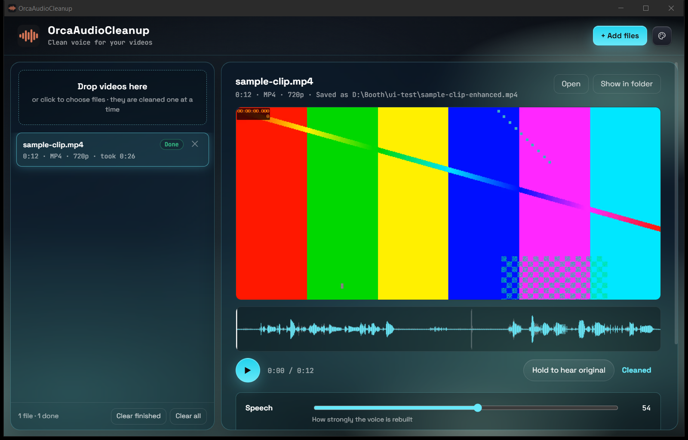

# OrcaAudioCleanup for Windows

**Clean the voice in your videos, on your own PC.**

[squarecirclelabs.com](https://squarecirclelabs.com/) · Mac version: [OrcaAudioCleanup-Mac](https://github.com/24pfilms/OrcaAudioCleanup-Mac)



Drop in a video or audio file and `<name>-enhanced` appears beside the original. The voice is rebuilt
so it sounds like a good mic, wind, room echo and noise are turned down, and the picture is copied as
it was. Everything runs on your computer: no account, no upload, no length limit.

Built on [Booth](https://github.com/shrimbly/booth) by shrimbly (MIT licence), ported to Windows.

## Install

### ⬇️ [Download OrcaAudioCleanup-Setup.exe](https://github.com/24pfilms/OrcaAudioClean/releases/latest/download/OrcaAudioCleanup-Setup.exe)

Windows 10 or 11 (64-bit), about 4 GB of free disk space, and an internet connection for the first setup.

> [!IMPORTANT]
> **Windows will warn you about this app. That is expected, and here is why.**
> OrcaAudioCleanup is free and made by one person. It is **not signed** with a paid Microsoft
> certificate, so Windows doesn't recognise it and shows a warning before it lets you install it.
> The app is safe to run: every line of its code is public in this repository.
> Follow the steps below **exactly**; you only do this once.

**Step 1. Download it.** Click the download link above.

Your browser may warn you too, because few people have downloaded this file yet:

- **Microsoft Edge** says *"OrcaAudioCleanup-Setup.exe isn't commonly downloaded."*
  Point at that message and click the **three dots (…)** → **Keep** → **Show more** → **Keep anyway**.
- **Google Chrome** may say the file *"isn't commonly downloaded"* or is *"unverified"*.
  Click the download (top right) and choose **Keep** (or **Download anyway**).
- **No warning?** Good, go on.

**Step 2. Open it.** Double-click `OrcaAudioCleanup-Setup.exe` in your **Downloads** folder.

**Step 3. Get past the blue "Windows protected your PC" box.** This is the important one.

```
┌──────────────────────────────────────────────────────────┐
│  Windows protected your PC                               │
│                                                          │
│  Microsoft Defender SmartScreen prevented an             │
│  unrecognized app from starting. Running this app        │
│  might put your PC at risk.                              │
│  More info   ◀── 1. CLICK THIS (small underlined text)   │
│                                                          │
│                                        [ Don't run ]     │
└──────────────────────────────────────────────────────────┘
```

1. Click the small underlined words **More info**. (There is no Run button until you do.)
2. A **Run anyway** button appears at the bottom, next to *Don't run*. Click **Run anyway**.

   It will say *Publisher: Unknown publisher*. That is the missing certificate, nothing else.

**Step 4. Click through the installer.** Click **Next** and **Install**. A second window opens and
downloads the engine and the voice models (about 2 GB, once). **Leave it open**: it takes 10 to 20
minutes and closes by itself. Then click **Finish**.

You now have an **OrcaAudioCleanup** icon on your desktop and in the Start menu, and a
*Clean up audio with OrcaAudioCleanup* item when you right-click a video.

**If something goes wrong**

- **The download window stopped with a red message:** check your internet, then open the Start menu
  and run **Finish OrcaAudioCleanup setup**. It carries on where it stopped.
- **"Smart App Control blocked an app"** (no *Run anyway* button at all): your PC blocks every
  unsigned app, not just this one. The only way round it is to turn Smart App Control off in
  *Windows Security → App & browser control*. That is a PC-wide safety choice, so only do it if you're comfortable.
- **Remove it:** *Settings → Apps → Installed apps → OrcaAudioCleanup → Uninstall*. This removes the
  app, its engine and its models. It never touches your videos or the cleaned copies.

### Install from the source code (for developers)

1. Install [uv](https://docs.astral.sh/uv/) and ffmpeg (in PowerShell):
   ```
   winget install astral-sh.uv Gyan.FFmpeg
   ```
2. Download this repo (green **Code** button → **Download ZIP**, then unzip it) or `git clone` it.
3. In that folder, open PowerShell and run:
   ```
   uv sync --python 3.11 --extra ui
   uv run booth setup
   powershell -ExecutionPolicy Bypass -File .\Install-OrcaAudioCleanup.ps1
   ```
   `booth setup` downloads the voice models (about 1.1 GB) once. The last line adds a desktop icon,
   a right-click menu for videos and a **Send to** entry. `Uninstall-OrcaAudioCleanup.ps1` removes them.

Either way, the window's list and preview sounds, and the models the app downloads, go in
`%LOCALAPPDATA%\OrcaAudioCleanup`. To keep them on another drive, set the `ORCA_AUDIO_HOME`
environment variable to a folder there.

## Use it

**The window** (desktop icon): drag videos in, wait, click a finished one and press Play.
Hold **Hold to hear original** to hear the old sound; let go for the new one. Then move the sliders:

- **Speech:** how strongly the voice is rebuilt (default 54)
- **Background:** how much of the room, or the sea, to keep (default 10)
- **Music:** how much music to keep

**Save this mix** rewrites the cleaned files with your settings in about a second.

**Quick clean** (no window): right-click a video → *Clean up audio with OrcaAudioCleanup*
(Windows 11: *Show more options* first), or select several → *Send to* → *OrcaAudioCleanup*.

**Command line:** `OrcaAudioCleanup.cmd "C:\path\video.mp4" -b 0 -m 0`

| Setting | What it does | Default |
|---|---|---|
| `-s 0-100` | How strongly the voice is rebuilt | 54 |
| `-b 0-100` | How much room sound and background to keep | 10 |
| `-m 0-100` | How much music to keep | 10 |
| `--audio-only` | Make only the .wav, no new video | off |
| `--no-split` | Skip the music step: faster, for talking-only videos | off |

`uv run booth enhance --help` lists every option.

## What you get

- `name-enhanced.mp4`: the same video with the cleaned sound (picture copied, no quality loss)
- `name-enhanced.wav`: the cleaned sound on its own, for your editor

Your original is never changed.

## Good to know

- **It rebuilds your voice**, it doesn't just filter it. Listen before you post.
- **Speed:** about 1.4 minutes of work per minute of video, on the processor (CPU).
- **Works with:** .mp4 .mov .mkv .webm .m4v .avi .mts, and .wav .mp3 .m4a .flac .aac.
- **A clip with no voice** (only wind or waves) comes out near-silent. That's expected: it keeps speech.

## How it works

```
original ──Sidon (generative restoration)──▶ studio speech ─▶ tone + gate ─┐
original ──demucs──▶ vocals ──DeepFilterNet3──▶ speech key + background    ├─▶ mix
                     music ────────────────────────────────────────────────┘
```

The voice comes from **Sidon** ([sarulab-speech/sidon-v0.1](https://huggingface.co/sarulab-speech/sidon-v0.1)),
a generative speech-restoration model that rebuilds clean 48 kHz speech instead of subtracting noise.
[docs/how-it-works.md](docs/how-it-works.md) has the full pipeline.

## Changes from Booth

Booth is a Mac menu-bar app. This repo keeps its engine (`src/booth`) and adds a Windows window
(`windows_app/`), the right-click and Send to scripts, and three small fixes so the engine runs on
Windows: model download output read on a thread, UTF-8 console output, and no Unix process groups.
The Mac app lives in [OrcaAudioCleanup-Mac](https://github.com/24pfilms/OrcaAudioCleanup-Mac).

## Licence

MIT. Booth's licence is kept unchanged in [LICENSE](LICENSE). The engine downloads its models under
their own licences: Sidon and w2v-BERT 2.0 (MIT), Demucs (MIT) and ClearVoice MossFormer2
(Apache 2.0). The window bundles JetBrains Mono and Space Grotesk (SIL Open Font License, licences in
`windows_app/ui/orca/fonts/`). [THIRD_PARTY_NOTICES.md](THIRD_PARTY_NOTICES.md) has the details.
